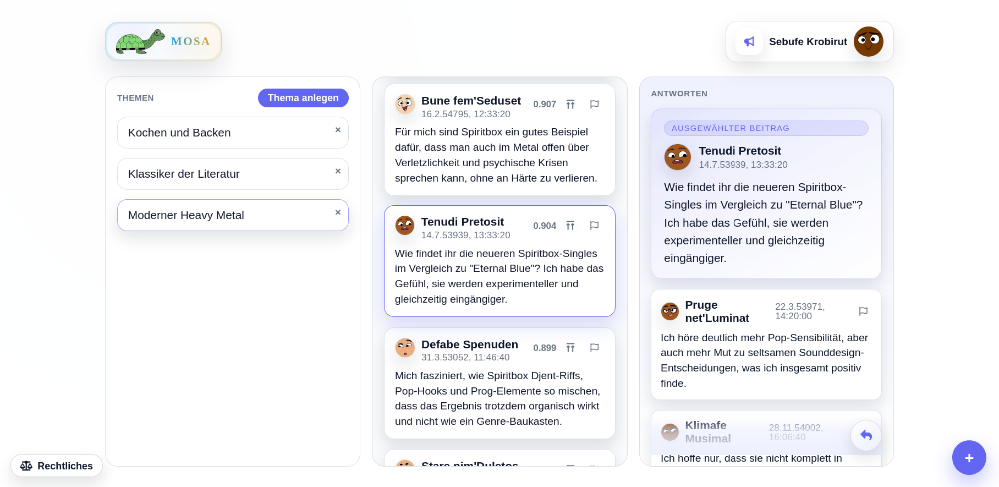

# Mosa

Mosa is a social network organized around **semantic topics**: people describe their interests in text, and posts are found by relevance rather than social connections. Its design uses independent servers (pods) and a web client.

## Quick facts

- **Topics:** text descriptions and embeddings support semantic discovery.
- **Identity:** cryptographic identities and pod-issued certificates use [MIS](spec/MIS1.0.md).
- **Structure:** a Ktor server, Kotlin/JS client, and shared Kotlin models; Lucene provides vector search.
- **Status:** see the [MVP scope](spec/mvp.md) for launch requirements and current coverage. The [concept](spec/Concept.md) also includes ideas and postponed features.

## Explore the repository

- [Architecture](spec/Architecture.md) — module boundaries and system design.
- [Pod API](spec/mosa-pod-api.raml) — API specification.
- [MVP scope](spec/mvp.md) — launch posture and outstanding requirements.
- [Documentation index](spec/README.md) — all specifications, design notes, and development guidance.

The main code is in `server/`, `client/`, and `shared/`; `tasks/` contains project task tracking.

## Licenses and attribution

Mosa is distributed under the [Apache License 2.0](LICENSE). The client uses Font Awesome Free and DiceBear Adventurer Neutral; details and other dependencies are listed in the [third-party license inventory](spec/ThirdPartyLicenses.md). The running client also provides notices under **Legal → Third-party notices**.
