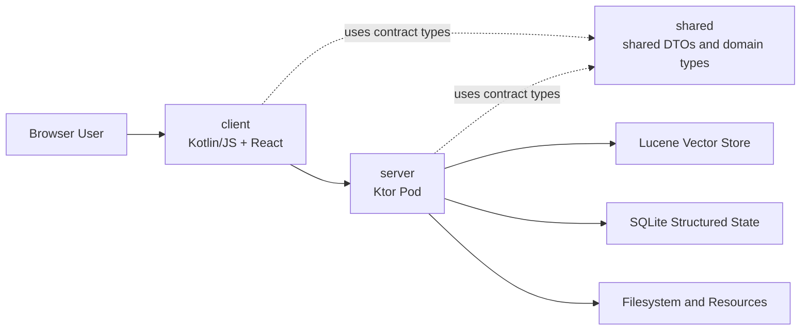
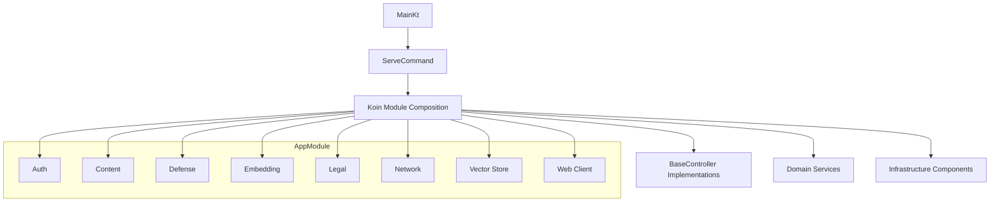
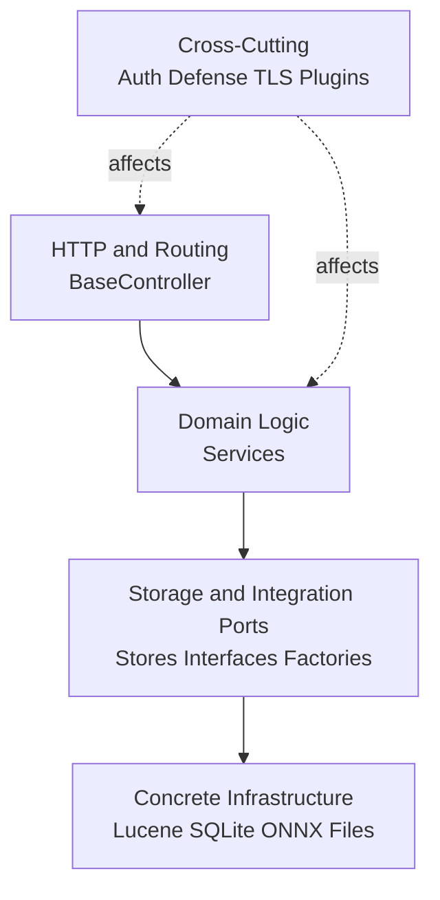
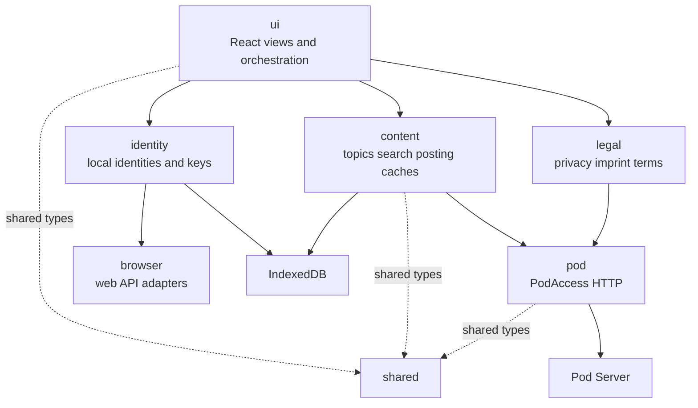
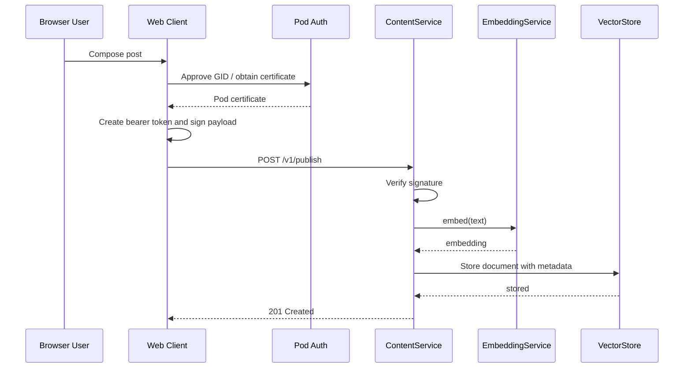

# MOSA Architecture

## Purpose and Context

MOSA is a federated, topic-oriented social network application. The system architecture is split into three primary parts:

- `server`: a Ktor-based pod server with HTTP API, authentication, persistence, semantic search, and legal document handling
- `client`: a Kotlin/JS web client with a React-based UI, browser persistence, and pod communication
- `shared`: shared DTOs, signature/protocol types, and cross-platform domain models

The architecture is intentionally modular: client, server, and shared contract objects are developed as one coherent software system.

## Top-Level Structure

### Module Structure

- Gradle multi-project build with the modules `:server`, `:client`, and `:shared`
- `:shared` is the shared contract module between frontend and backend
- The server packages the built web client into its static resources and serves it

### Overview Diagram

### Runtime Topology

- A MOSA pod runs as a single Ktor/Netty process
- The browser client communicates over HTTP with a pod base URL context and encapsulates that access behind dedicated pod access abstractions
- Semantic search and thread queries are executed on the server side
- Identity and authorization are based on cryptographic keys and [`MIS-JWT`](./MIS1.0.md) bearer tokens

## Architecture Principles

The most important structural characteristics of the project are:

- separation of responsibilities between UI, domain logic, infrastructure, and shared API contracts
- shared request/response types in `shared` to avoid contract drift between client and server
- composition through Koin instead of hard-wired construction
- thin HTTP controllers delegating domain logic to services
- local infrastructure instead of external platform services:
  Lucene for vector search, SQLite for structured state, ONNX/DJL for embeddings, browser IndexedDB for client state
- federation and security logic at pod level instead of centralized user management

## Server Architecture

### Entry Point and Composition

The server starts through `straightway.mosa.MainKt` and provides command-line subcommands for operation and data exchange:

- `serve`: starts the pod
- `export`: exports content
- `import`: imports content

The overall domain composition is assembled in `server/src/main/kotlin/straightway/mosa/AppModule.kt`. That module combines the submodules:

- Auth
- Content
- Defense
- Embedding
- Legal
- Network
- Vector Store
- Web Client Delivery

`ServeCommand` installs Koin into Ktor, loads all `BaseController` instances from the DI container, and registers their routes centrally. This keeps routing defined close to each controller while still composing it in one place.

### Server Configuration Model

Server configuration deliberately uses two mechanisms only:

- dedicated files in the server current working directory
- command-line parameters for everything else

There is no general-purpose server config file. If a setting is not represented by a dedicated file, it is configured through command-line options exposed by the server commands.

The files in the server current working directory are a deliberate part of the operating model. In particular, this includes the legal YAML files such as `mosa_privacy.yaml`, `mosa_terms.yaml`, and `mosa_imprint.yaml`, as well as the pod keypair file `mosa_pod_keypair.pem`.

This is an intentional architecture decision:

- persistent server-local configuration files are easy to discover because they live in one predictable place
- operators are expected to run the server with its own dedicated working directory
- the location of operational files stays obvious without an additional path indirection layer
- file-based configuration remains separate from generic runtime tuning through command-line arguments

### Server Composition Diagram

### Layering Model on the Server

The server does not follow a strict hexagonal framework, but it clearly exhibits an effective layered structure:

1. HTTP layer
   `BaseController` and concrete controllers in domain packages register endpoints, read requests, and serialize responses.
2. Domain logic
   Services such as `ContentService`, `AdminMessageService`, `PostComplaintService`, and `LegalService` encapsulate application logic.
3. Persistence and integration layer
   Lucene, SQLite, ONNX, file, and resource access are encapsulated in dedicated infrastructure classes.
4. Cross-cutting layer
   Authentication, signature verification, rate limits, TLS configuration, and Ktor plugins cut across modules.

This structure keeps the web layer relatively thin and concentrates behavior in reusable services.

### Main Domain Areas

#### Content

`straightway.mosa.content` is the largest domain area. It contains:

- publishing posts and replies
- semantic queries and thread queries
- fetch and export functionality
- deleting owned content
- deleting entire identities
- privacy snapshots for export and restore
- complaint and administrative messaging through adjacent subpackages

`ContentService` combines embedding generation and vector store access. Writing content means:

1. validate the text
2. generate an embedding
3. write the document plus metadata into the vector index

Reading content means:

1. interpret query criteria
2. optionally generate a topic embedding
3. search against the vector store
4. project results into API DTOs

#### Auth

`straightway.mosa.auth` encapsulates:

- Ed25519 key generation and persistence for the pod
- certificate issuance for client identities
- JWT generation and verification
- Ktor authentication integration

In this context, a `GID` is the stable cryptographic identifier of a client identity. It is the identity value that the pod certifies, that the client uses in authentication flows, and that other deterministic identity representations such as fictional names and avatars are derived from.

The server identity is therefore a fixed infrastructure element of a pod. Clients do not authenticate through classic accounts, but through cryptographic identities with pod certificates.

#### Legal

`straightway.mosa.legal` forms a dedicated subsystem for legal documents:

- loading YAML-based profiles
- validating document chains
- rendering and canonicalizing [`ClearTerms`](./ClearTerms1.0.md)
- exposing imprint, privacy, and terms documents over HTTP

Architecturally, this is intentionally separated from content and UI and has its own resources, parsers, and validators.

#### Defense

`straightway.mosa.defense` groups protection mechanisms such as rate limits, block lists, and admin allow lists. This logic is a cross-cutting module and is used both in the HTTP pipeline and inside domain services.

#### Message and Complaint

Administrative messages and post complaints are separate domain areas with their own:

- controller
- service
- store abstraction
- SQLite implementation

They are related to the content context, but they are organized as their own submodules.

## Persistence and Data Architecture

### Polyglot Local Storage

The server intentionally uses multiple local storage technologies instead of a single database:

- Lucene:
  storage and semantic search for posts and replies including metadata
- SQLite:
  structured application state such as admin messages and complaints
- filesystem:
  pod keys, snapshot keys, legal YAML files, and other configuration
- classpath resources:
  bundled baseline documents and server documentation

This split is one of the key architecture characteristics of the project. Semantic content and strongly structured administrative state are deliberately stored differently.

The filesystem aspect is also used as a simple persistent server configuration boundary. Files that define persistent pod-specific configuration are deliberately expected in the server current working directory. This keeps the operational model explicit: the operator gives the server its own directory, and the relevant files are located there rather than being spread across unrelated paths or hidden behind a separate global config file.

### Structured State

SQLite access is encapsulated through `StructuredStateContext` and `StructuredStateDatabase`. The important property is:

- coordinated operations can run inside a transaction-bound context without passing raw Exposed transactions through service APIs

This reduces coupling to Exposed and keeps service interfaces more domain-oriented.

### Vector Store

The vector store is abstracted behind the `VectorStore` interface. The current implementation is local and Lucene-based. This keeps semantic search as a clearly bounded infrastructure building block.

## Client Architecture

### Entry Point and Composition

The web client starts in `client/src/jsMain/kotlin/straightway/mosa/client/Main.kt`:

- load styles
- start Koin
- render the React root

The central browser composition is located in `AppModule.kt`. That module wires together the HTTP client, browser APIs, persistence adapters, domain services, renderers, and utility components.

### Client Structure Diagram

### Main Structural Areas in the Client

- `ui`:
  React components, view state, and UI orchestration
- `identity`:
  browser-side identities, key management, transfer, and selection
- `content`:
  topic management, search, posting, replying, caches, deletion, and snapshots
- `pod`:
  HTTP access to pod endpoints via `PodAccess`
- `legal`:
  display and preparation of legal documents
- `i18n` and `localization`:
  translation and localization
- `browser`:
  thin adapters around web platform APIs

### Identity Visual Mapping

Identities are directly mapped to a stable fictional display name and a stable avatar.

A `FictionalName` is a generated human-readable pseudonym composed from generated given-name and surname parts. It is not free-form profile text. Instead, it is deterministically derived from the identity bytes.

The client derives both visual identity elements directly from the GID:

- the same identity always maps to the same `FictionalName`
- the same identity always maps to the same avatar
- neither the `FictionalName` nor the avatar is user-editable

This is a deliberate design decision. MOSA does not rely on mutable profile names or uploaded profile images for recognition. Instead, it uses deterministic identity visuals so that an identity remains reliably recognizable across the UI without introducing editable public profile attributes.

### State and Persistence Model in the Browser

The client is not a purely stateless frontend. It has its own local persistence:

- IndexedDB for identities
- IndexedDB for topics
- IndexedDB for post and reply caches
- browser-based certificate and session components

This makes the browser client a state holder in its own right instead of only being a remote view over server data.

### Network Boundary

`PodAccess` encapsulates HTTP communication with the pod. Architecturally important points are:

- the rest of the client works against a domain-level access port instead of directly issuing Ktor calls
- request and response types come from `shared`
- authenticated calls use [`MIS-JWT`](./MIS1.0.md) as bearer token

## Shared Module as Contract Core

`shared` contains the cross-platform API and model core:

- authentication DTOs
- content requests and responses
- snapshot and deletion results
- legal and message types
- selected utility and identity classes

This module is a central stabilization boundary in the architecture. Changes to externally visible contracts should generally start here and then be implemented in both client and server.

## Important Runtime Flows

### Publish a Post

1. The client creates or loads a local identity.
2. The client obtains a pod certificate and creates a [`MIS-JWT`](./MIS1.0.md).
3. The client signs the content and calls the publish endpoint.
4. The server authenticates the request and verifies the signature.
5. The server generates an embedding.
6. The server writes text and metadata to the Lucene-based vector store.

### Semantic Search

1. The client sends a topic description.
2. The server generates an embedding from it.
3. The vector store searches for similar documents.
4. The server returns matching entries including metadata to the client.

### Privacy Snapshot

1. The client requests a binary snapshot.
2. The server collects relevant data from the involved stores.
3. The snapshot is cryptographically processed and returned as a download.
4. For restore, the client uploads the binary file again and the server validates and writes the restored state.

## Coupling and Integration Boundaries

The most important dependency directions are:

- `client` and `server` both depend on `shared`
- `server` does not depend on client source code, only on the built bundle as a resource
- domain services depend on interfaces or factories for storage access, not on HTTP
- controllers depend on services, not the other way around
- the client hides pod access behind `PodAccess` and browser storage behind store interfaces

These directions prevent UI, HTTP, or concrete storage technology from dominating the whole codebase.

## Deliberate Architecture Decisions

The most important architecture-relevant decisions in the current state are:

- monolithic pod process instead of a distributed backend
- shared contract module for client and server
- semantic content in Lucene, administrative state in SQLite
- browser client with local identity and data state
- composition through Koin instead of framework magic or reflection-based discovery
- legal documents as a dedicated subsystem with YAML sources and [`ClearTerms`](./ClearTerms1.0.md) processing
- frontend bundle served by the backend instead of a separately deployed frontend artifact

## Non-Goals of This Document

This document describes the top-level architecture. It does not replace:

- the API details in [`spec/mosa-pod-api.raml`](./mosa-pod-api.raml)
- the [`MIS`](./MIS1.0.md) specification
- the [`ClearTerms`](./ClearTerms1.0.md) specification
- detailed UI planning or task history

For detailed questions, the relevant code area and the corresponding focused specification should always be considered in addition to this document.
