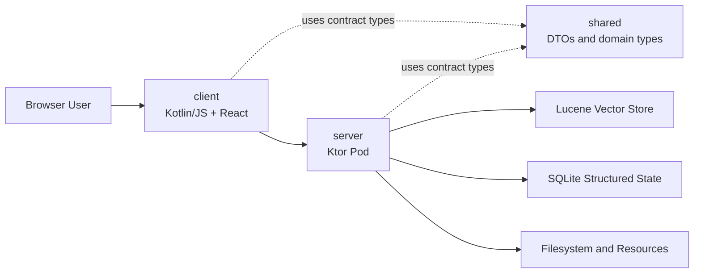
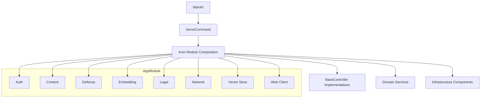
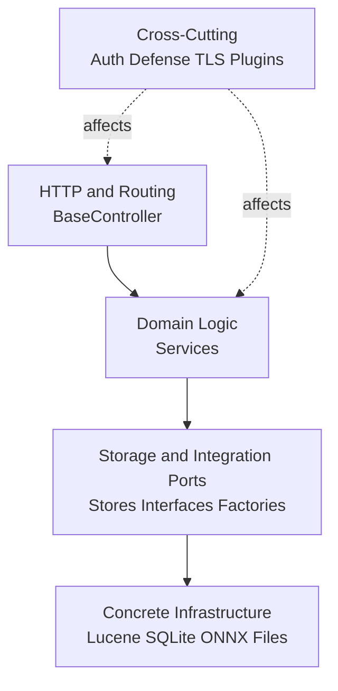
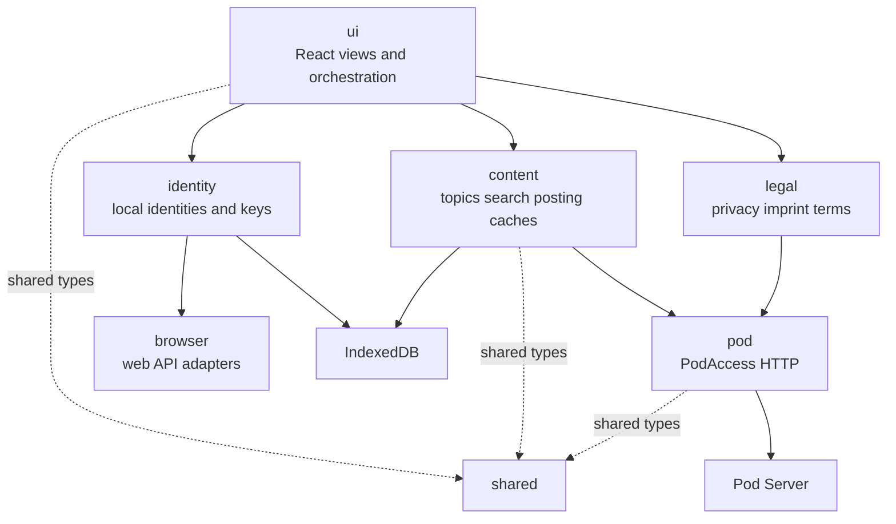
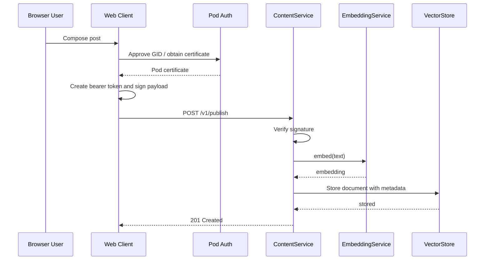

# MOSA Architecture

## Purpose

MOSA is federated, topic-oriented social network with three modules:

- `server`: Ktor pod server with HTTP API, auth, persistence, semantic search, legal docs
- `client`: Kotlin/JS web client with React UI, browser persistence, pod access
- `shared`: shared DTOs, protocol/signature types, cross-platform models

Client, server, and shared contracts evolve as one system.

## Top-Level Structure

- Gradle multi-project build: `:server`, `:client`, `:shared`
- `:shared` is contract boundary between frontend and backend
- server serves built client bundle as static resource
- one pod runs as single Ktor/Netty process
- browser client talks to pod over HTTP
- semantic search runs on server
- identity and auth use cryptographic keys and [`MIS-JWT`](./MIS1.0.md)

## Core Principles

- clear split between UI, domain logic, infrastructure, and shared contracts
- shared request/response types prevent contract drift
- Koin composes system
- thin HTTP controllers delegate to services
- local infrastructure over external platform services:
  Lucene for semantic search, SQLite for structured state, ONNX/DJL for embeddings, IndexedDB for client state
- federation and security stay at pod level

## Server

Server owns pod runtime, domain logic, security, persistence, semantic search.

### Composition

Entry point: `straightway.mosa.MainKt`

Commands:

- `serve`
- `export`
- `import`

Main wiring: `server/src/main/kotlin/straightway/mosa/AppModule.kt`

Submodules:

- Auth
- Content
- Defense
- Embedding
- Legal
- Network
- Vector Store
- Web Client Delivery

`ServeCommand` installs Koin, loads `BaseController` instances from DI, registers routes centrally.

### Configuration

Server configuration uses only:

- dedicated files in current working directory
- command-line parameters for everything else

Important working-directory files:

- `mosa_privacy.yaml`
- `mosa_terms.yaml`
- `mosa_imprint.yaml`
- `mosa_pod_keypair.pem`

This keeps pod-local state and config discoverable without global config indirection.

### Layers

1. HTTP: controllers parse requests, register endpoints, serialize responses
2. Domain: services such as `ContentService`, `AdminMessageService`, `PostComplaintService`, `LegalService`
3. Persistence/integration: Lucene, SQLite, ONNX, file, resource access
4. Cross-cutting: auth, signature verification, rate limits, TLS, Ktor plugins

### Main Domain Areas

#### Content

`straightway.mosa.content` covers:

- posts and replies
- semantic and thread queries
- fetch and export
- deletion of owned content and identities
- privacy snapshots
- adjacent complaint and admin messaging flows

`ContentService` combines embedding generation and vector store access.

Write flow:

1. validate text
2. generate embedding
3. store document and metadata in vector index

Read flow:

1. interpret query
2. optionally generate topic embedding
3. search vector store
4. project results to API DTOs

#### Auth

`straightway.mosa.auth` covers:

- Ed25519 pod keys
- certificates for client identities
- JWT generation and verification
- Ktor auth integration

`GID` is stable cryptographic client identity. Pod certifies it. Client uses it for auth. Deterministic visual identity derives from it.

#### Legal

`straightway.mosa.legal` handles:

- YAML legal profiles
- document-chain validation
- [`ClearTerms`](./ClearTerms1.0.md) rendering and canonicalization
- HTTP delivery of imprint, privacy, and terms

#### Defense

`straightway.mosa.defense` groups rate limits, request shedding, IP blocking, and admin allow lists. It is cross-cutting.

#### Message and Complaint

Administrative messages and post complaints have separate controller, service, store abstraction, and SQLite implementation.

## Persistence

Server uses polyglot local storage:

- Lucene: semantic content and metadata
- SQLite: structured state such as admin messages, complaints, and blocked identities
- filesystem: pod keys, snapshot keys, legal YAML, persistent pod-local config
- classpath resources: bundled baseline documents and server documentation

`StructuredStateContext` and `StructuredStateDatabase` wrap SQLite access so service APIs do not expose raw Exposed transactions.

Semantic search is abstracted behind `VectorStore`. Current implementation is local and Lucene-based.

## Client

Client is thin compared to server, but not stateless. It owns browser-local identity, caches, and pod access orchestration.

### Composition

Entry point: `client/src/jsMain/kotlin/straightway/mosa/client/Main.kt`

Startup:

1. load styles
2. start Koin
3. render React root

Main browser wiring lives in `AppModule.kt`. It composes HTTP client, browser APIs, persistence adapters, domain services, renderers, and utility components.

### Main Areas

- `ui`: React components, view state, orchestration
- `identity`: browser identities, key management, transfer, selection
- `content`: topics, search, posting, replies, caches, deletion, snapshots
- `pod`: HTTP access through `PodAccess`
- `legal`: legal document display
- `i18n` and `localization`: translation and localization
- `browser`: thin web API wrappers

### Identity and State

Identity maps deterministically to:

- stable `FictionalName`
- stable avatar

Neither is user-editable.

Client keeps local browser state:

- IndexedDB for identities
- IndexedDB for topics
- IndexedDB for post and reply caches
- browser-based certificate and session components

`PodAccess` is network boundary. Rest of client talks to domain-level port, not raw HTTP. Shared request/response types come from `shared`. Authenticated calls use [`MIS-JWT`](./MIS1.0.md).

## Shared

`shared` contains cross-platform contract core:

- auth DTOs
- content requests and responses
- snapshot and deletion results
- legal and message types
- selected utility and identity classes

Externally visible contract changes should usually start here.

## Important Runtime Flows

### Publish Post

1. client creates or loads local identity
2. client obtains pod certificate and creates [`MIS-JWT`](./MIS1.0.md)
3. client signs content and calls publish endpoint
4. server authenticates request and verifies signature
5. server generates embedding
6. server stores text and metadata in Lucene

### Semantic Search

1. client sends topic description
2. server generates embedding
3. vector store searches similar documents
4. server returns matches with metadata

### Privacy Snapshot

1. client requests binary snapshot
2. server collects data from relevant stores
3. server cryptographically processes snapshot and returns it
4. restore uploads snapshot again, server validates and writes restored state

## Dependency Boundaries

These boundaries are main guardrails for change. They keep feature work local instead of letting HTTP, UI, or storage details leak through whole system.

- `client` and `server` depend on `shared`
- `server` does not depend on client source, only built bundle
- controllers depend on services
- services depend on storage interfaces or factories, not HTTP
- client hides pod access behind `PodAccess`
- client hides browser persistence behind store interfaces

These boundaries keep UI, HTTP, and concrete storage tech from dominating whole codebase.

## Deliberate Decisions

- monolithic pod process, not distributed backend
- shared contract module for client and server
- semantic content in Lucene, administrative state in SQLite
- browser client keeps local identity and data state
- Koin composition instead of framework magic or reflection-based discovery
- legal documents as dedicated subsystem with YAML sources and [`ClearTerms`](./ClearTerms1.0.md)
- backend serves frontend bundle

## Out of Scope

This document does not replace:

- [`spec/mosa-pod-api.raml`](./mosa-pod-api.raml)
- [`MIS`](./MIS1.0.md)
- [`ClearTerms`](./ClearTerms1.0.md)
- detailed UI planning
- task history
