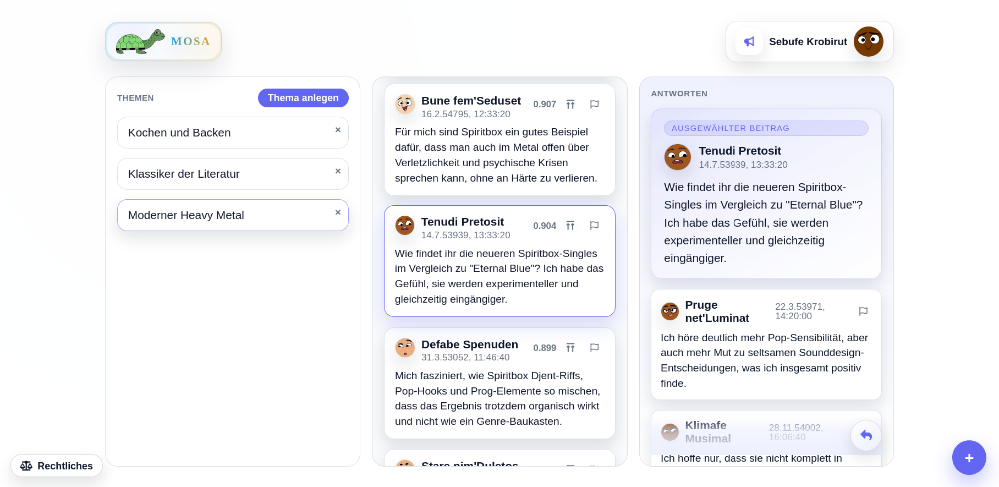

# Mosa Concept and Ideas

This document preserves the original project concept, including proposals and postponed features. It is not a statement of current implementation or the authoritative API contract. See [MVP scope](mvp.md), [architecture](Architecture.md), and the [pod API](mosa-pod-api.raml) for their respective scopes.

## Core Concept

A federated social network that organizes content exclusively by **semantic topics** instead of social connections. Users follow topics (defined by text descriptions), not people. Content is discovered and clustered via embedding vectors.

## Screenshot

## Basic Architecture

### Pods (Servers)

* **Semantic Query**: A pod allows querying posts by semantic similarity using an embedding model and a vector store, ordered by relevance. Clients query topics by providing a description of the topic in text.
* **Thread Query**: A pod also allows querying all replies to a given thread root document, ordered by storage time.
* **Thematic Specialization**: Each pod can optionally define a number of topic areas with its own textual representations. If a pod defines no topic area, it accepts all topics.
* **Content Filtering**: Accepts only posts that fit its topics. A reply is only accepted if it fits the topic of the root post.
* **No Login Required**: Login and identity management is done via [MIS](MIS1.0.md) without user interaction

### Web-Clients

* **Topic Definition**: The user describes interest groups in text.
* **Query**: Client sends topic definition (which may be an exemplary message or a written definition) as part of a query to a pod.
* **Federated Polling**: Clients regularly query relevant pods.

## Identity and Posting System

### Client Identity

* **Cryptographic key pair as identity**: Clients generate a cryptographic key to prove their identity.
* **Identity approval by signing**: Pods can grant a certificate for a client identity and thus approve access to the pod.
* **Long-Lived Identities**: Client identities act like pseudonymous accounts and may be used to access multiple pods (each must approve the identity)

### Access Control

* **Automatic sign-in**: Clients automatically request a certificate from a pod for their identity.
* **[MIS-JWT](MIS1.0.md) as bearer token**: Clients must build a MIS-JWT and provide it as bearer token with every REST request to a pod.
* **Rate limiting by identity approval**: Pods may delay or temporarily refuse the approval of identities and/or revoke certificates in high load scenarios. This is a protective measure.
* **Optional Later: Fine-Grained Access Rights**, idea:
    - User authentication via OIDC (e.g. through Keycloak).
    - Group membership stored in the MIS-JWT

## Federation and Discovery

### Pod-to-Pod Communication

* **Federation**: Pods provide a special endpoint to query their “recommended” pods, which may be accessed by other pods.
  * Idea: Pods may add the group descriptions of other pods into their own vector store, with a special marker that this is a "foreign group definition". If this occurs in the results of a KNN search, this is transmitted as "recommendation" to the client. Of course, this has the challange of keeping the "foreign group definitions" up to date in case they change. This may be achieved with a time-to-live and regularly polling.
* **No Automatic Block-List Sharing**: Each pod remains sovereign in moderation decisions.

### Client Discovery

* **Bootstrap**: Start with a seed list of known pods.
* **Adaptive Learning Curve**: The client learns which pods are relevant for which topics.
* **Topic discovery**: Pods may provide a special endpoint to query the topics they support.
* **Emergent Quality Signals**: Well-curated pods receive more traffic.

## Content Moderation

### Architecture-Based Moderation

* **Decentralized Moderation**: Each pod moderates its own content.
  * Idea: The pod maintains a list of exemplary unwanted (e.g. hat speech) and wanted or neutral posts and checks the vector similarity of a given post to this list. If unwanted exemplary posts are top-ranked, the user post may be rejected.
* **Thematic Barriers**: Spam and off-topic posts are automatically routed into appropriate groups.
* **Delayed Token Approval by Pods**: Makes spam attacks exponentially more expensive, because spammers would have to request approval for a big number of identities.
* **User Choice**: Users decide on moderation standards by choosing pods.

### Quality Control

* **On-Topic Detection**: A post is regarded on-topic with another post, if they are within a given result range with each other in a KNN query. It is clear, that this works poorly if a pod has only very few posts, but this is accepted as a temporary problem.
* **Smart Routing**: If a post is regarded off-topic, it is rejected with a HTTP status 422 Unprocessable Content. The pod may give hints in the reply body to other pods which may better fit with that topic.
* **Voting with Their Feet**: Users can simply ignore unsuitable pods.
* **Voting of posts (postponed)**: In a later version, it may be possible for users to vote single posts. But it should be avoided, that users always vote posts of friends, just because they are friends. It is thinkable to only vote replies to posts, and first only the original author can vote replies to the post. If the original author upvoted some comments, also the authors of these upvoted comments may vote with the thread. Maybe only authors of upvoted posts may vote related other root posts. This concept is not yet finished. Maybe alternative: Reaction weight by semantic distance.

## **Protection Against Cyber Attacks**

* **Blacklisting**:
    - Users (via identity)
    - IP addresses or subnets
* **Adaptive Measures**
    - Token approval can be delayed to counteract pod overload caused by DDoS attacks using newly created tokens.
    - Any access requires a token to counter overload or DDoS attacks. The token can be used to selectively delay or blacklist specific users.
* **Efficient Defensive Measures**: Rejecting and delaying access efficiently to avoid pod overload.

## API Specification

### General conventions

1. Unless explicitly stated, every endpoint requires that a valid MIS-JWT is passed as bearer token.
2. All endpoints are below a `/v1` path, which designates the API version
3. All endpoints may answer with `429 Too Many Requests` including a `Retry-After` response header to protect themselves in high load scenarios.

### Content Endpoints

#### Create a new post: `POST /v1/publish`

The posted text is submitted via the request body.

#### Reply to a post or another reply: `POST /v1/reply`

Might be rejected if off-topic.

The posted text as well as a reference to the original post is submitted via the request body.

#### Rate a post or reply: `POST /v1/vote` (postponed)

The voting or rating as well as a reference to the voted post is submitted via the request body.

#### On-topic search: `POST /v1/query`

The following parameters may be transmitted via the request body:

1. The text defining what is on-topic.
2. Result count limit.
3. Optional: The minimum timestamp for the search. Yields only result with a timestamp greater or equal.
4. Optional: The root post for the search. Yields only results with the same root post.

The result is a list of query results, plus a query ID which may be passed to the `/v1/queryon` endpoint to get the next result chunk.

#### Load next results for an existing search: `POST /v1/queryon`

The query ID from the original `/v1/query` request must be passed in the request body. This endpoint may be called on and on and on until it yields an empty result.

The result is a list of the next query results.

To allow pods efficient life cycle handling and data cleanup, the validity of the query ID may be terminated by the pod at any time.

#### Info about the pod's configuration: `/v1/info` (postponed)

Returns info about the pod's configuration, e.g. supported API version.

### Discovery Endpoints

#### Supported topics: `GET /v1/topics` (postponed)

Get the topics supported by the pod. Replies with a list of embedding vectors

#### Known pods: `GET /v1/pods`

Get a list of other known pods. Replies with a list of other pods' host names.

Which pods are returned by is configured by the pod administrator.

### Token Management

#### Request identity approval: `POST /v1/approvegid`

The client's `gid` according to [MIS](MIS1.0.md) is passed via request body. This is the only request *not* requiring a bearer token header.

The pod answers with a MIS certificate for the transmitted `gid`.

## Technical Implementation

### Client Side

* **Polling Strategy**: Intelligent prioritization of relevant pods.
* **Save storage of crypto-identities**: How is this possible in a browser?

### Server Side

* **Vector Database**: Lucene for now.
* **Rate Limiting**: Protection against spam and overload.
* **Content Cleanup**: Automatic deletion of old/unpopular posts.

## Extended Features

### Comment System

* **Thread Structure**: Comments are stored on the original pod.
* **Always On-Topic**: Comments must be within a certain range with original post in KNN searches.

## Advantages over Traditional Social Networks

1. **Thematic Coherence**: Content is organized by relevance, not by social connections.
2. **Natural Spam Resistance**: Architecture-based filtering.
3. **Implicit Moderation**: No central censorship authority, posts are grouped on-topic by design.
4. **Low Entry Barriers**: Access with minimal effort, automatic registration.
5. **Pseudonymous Participation**: Privacy-friendly without total anonymity.
6. **Discovery**: Users don’t have to learn which pods are relevant; pod discovery automatically guides them.

## Possible Challenges

1. **Scalability**: Efficient vector search with large datasets.
2. **Spam Resistance**: Although filtered by architecture, thematically fitting spam could appear.
3. **Quality Control**: Thematic relevance ≠ content quality.
5. **Filter-Bubble Risk**: Even though thematic diversity is possible within topics.

## Attribution

The web client bundles [Font Awesome Free](https://fontawesome.com) by Fonticons, Inc. Its icons are licensed under CC BY 4.0, its web fonts under SIL OFL 1.1, and its code under MIT.

The web client uses the DiceBear Adventurer Neutral avatar style, designed by Lisa Wischofsky and licensed under [CC BY 4.0](https://creativecommons.org/licenses/by/4.0/).

The complete third-party notices are available in the running web client under **Legal → Third-party notices**. The server distribution also contains `SERVER-THIRD-PARTY-NOTICES.txt` and the original license and notice files from its runtime dependencies.
